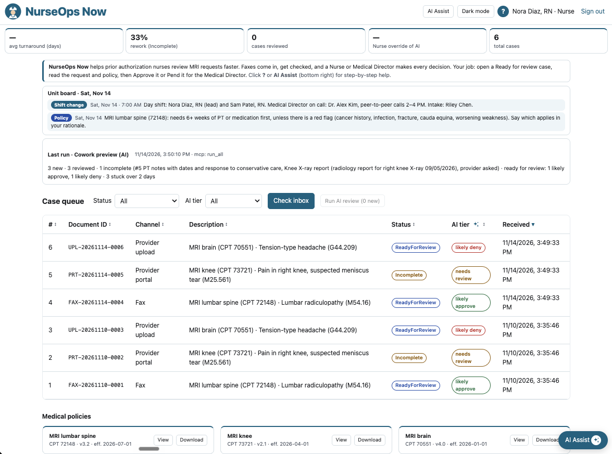
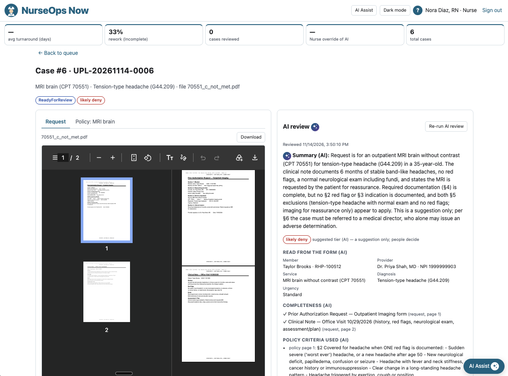
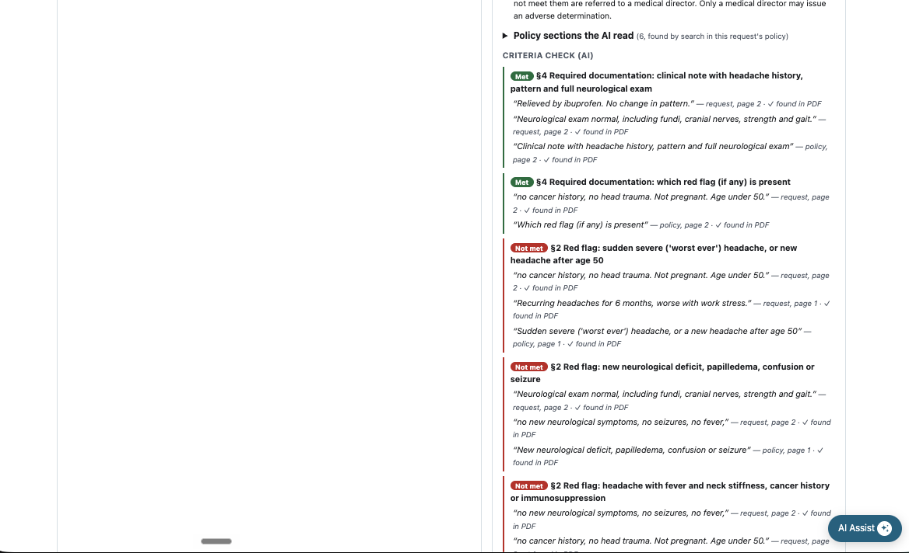
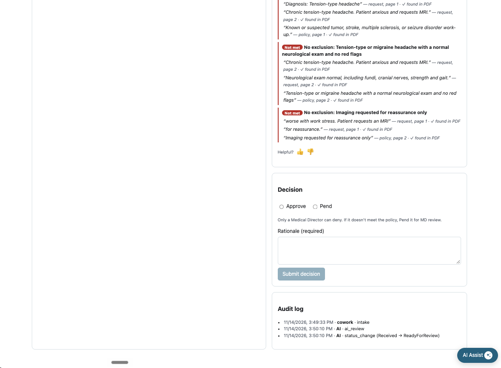
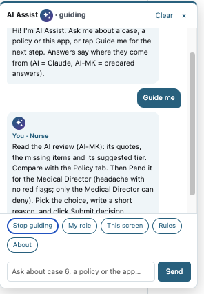
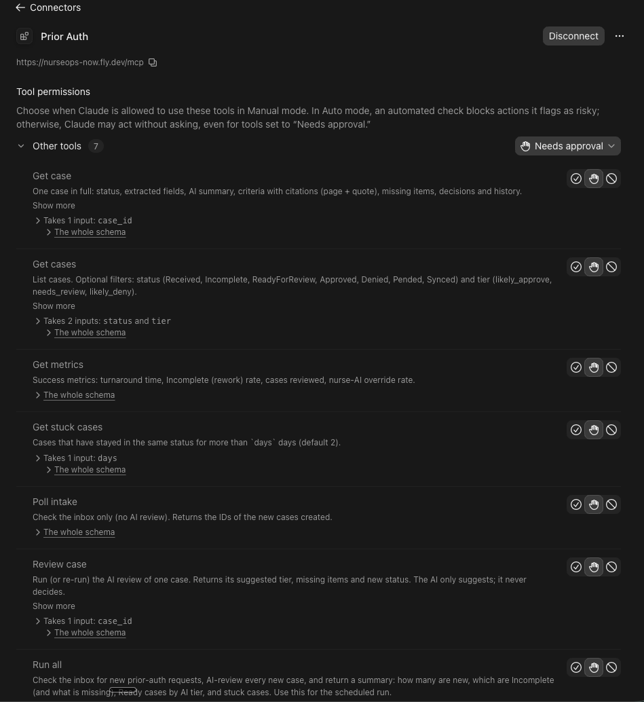
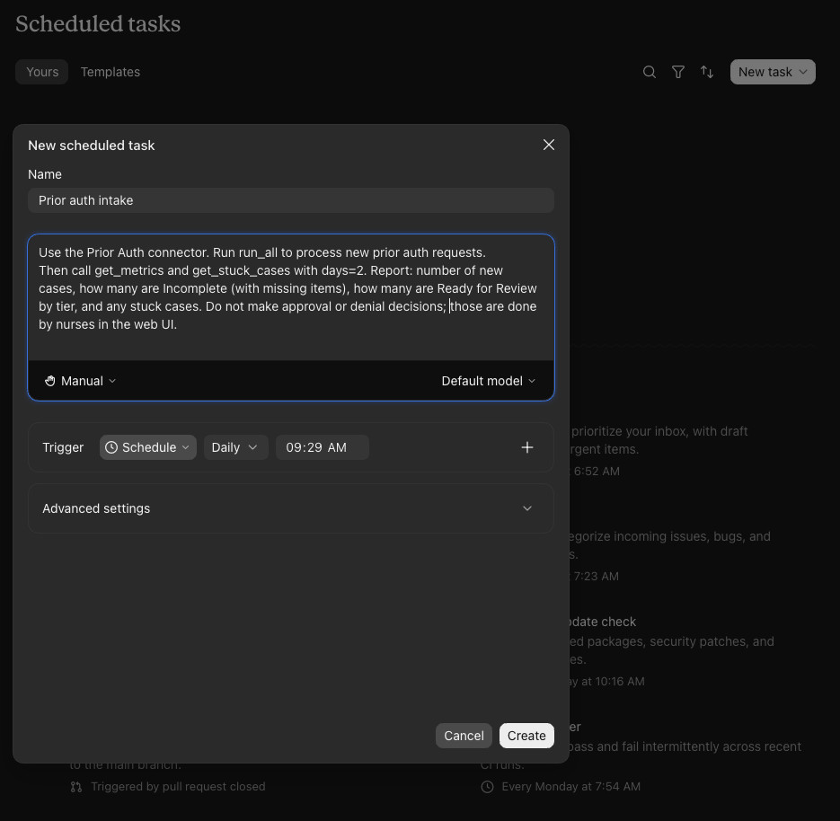
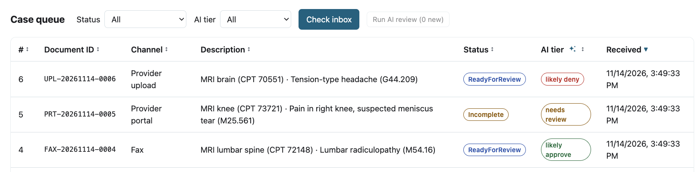

# NurseOps Now in plain terms

How the app works and why the 3 AI opportunities matter, in plain language with a **Tech** note under each part. Screenshots are from the live app on 2026-11-14. Live site: [nurseops-now.fly.dev](https://nurseops-now.fly.dev). Talk: [short script](../demo/1-short_script.html) · details: [demo script](../demo/4-demo-script.html) · all features: [feature blog](nurseops-now-blog.html).

## #1 What the app is

When a doctor wants an expensive test for a patient, like an MRI, the health plan must say yes first. That's **prior authorization**. Today nurses at the plan read every request by hand (faxes, PDFs, uploads), check it against the plan's rules for that test, and decide. It's slow: 4.2 days on average, and 22% of requests come back because something was missing.

NurseOps Now is like giving that nurse team a very fast assistant that reads everything first and gets it ready, while the nurses still make the call. The goal is 40% faster (about 2.5 days) with no extra hires. That's a target; the prototype hasn't measured it on real work.

> **Tech:** We used **FastAPI** (Python) to build one **service layer** that holds every rule, status change and log entry, **React + TypeScript (Vite)** for the web app, and **SQLite** through **SQLAlchemy** to store cases, decisions and the audit log, with the PDFs in a file folder (swappable later for Postgres and S3). We used **Docker** to package it and **Fly.io** to host it live, with the data on a persistent volume.

## #2 Opportunity 1: catch missing paperwork right away

**Today:** a request sits in a pile for days. When a nurse finally opens it, the physical therapy notes are missing, so she asks the doctor's office and waits again.

**With the app:** the moment the request arrives, it becomes a case and AI reads that case's PDF, says "this one is missing the PT notes", and drafts the note to the doctor's office. The wait starts on day 1, not day 3.

**Why it's good:** it goes straight at the 22% rework, the biggest source of delay.

**Cowork's part:** Cowork starts this. Its scheduled task calls `run_all`, which turns **each PDF in the inbox into its own case** and has Claude **read and check that case's PDF**, one case at a time, without anyone clicking. Cowork's report then lists each incomplete case and exactly what's missing (for example, "Case 5 is missing PT notes and the knee X-ray report"). A person can do the same with **Check inbox** in the web app.

> **Tech:** We used the **Claude API** (Anthropic's LLM; Opus by default, Sonnet as fallback) to read the whole request PDF, sent as a native **document block** so Claude sees the text and the page images, and extract patient, CPT, ICD-10, provider and missing documents. We used **structured output** (`messages.parse`) with a **Pydantic** schema so Claude returns validated JSON, not free text. We used **pypdf** for page text and **RapidOCR** (local optical character recognition) for faxed or scanned pages, so no data leaves the server. We used a **regex** to read the CPT code in Python before calling the AI, so code picks the right policy. We used a mocked **notification service** to send the drafted provider request.

## #3 Opportunity 2: a study buddy for the nurse (copilot)

**Today:** the nurse reads a 10-page request and a 5-page policy and checks each rule herself.

**With the app:** AI has already done it: "Rule 1: met. Here's the exact sentence on page 2 that proves it." Then it suggests **likely approve**, **needs review** or **likely deny**. The app double-checks that every quoted sentence is really in the document, so the AI can't make things up.

**Why it's good:** the nurse goes from reading everything to checking the AI's work and deciding. She can still disagree, and the app records it when she does.

**Cowork's part:** the same `run_all` has Claude review every new case, and Cowork's report counts them by tier ("1 likely approve, 1 likely deny"). The full advice and the decision stay with the nurse in the web app; Cowork can't approve or deny.

> **Tech:** We used **RAG** (retrieval-augmented generation) to find only the policy rules that matter: **sentence-transformers** embeddings in a **Chroma** vector database, **hybrid search** (BM25 keyword plus vector similarity), a **cross-encoder re-ranker** and **query rewriting**, over policies split into clause-sized chunks. We used **LangGraph** to run the review as fixed steps: read the CPT, look up the policy, retrieve the criteria, Claude reviews, code verifies. We used **Python quote verification** so any quote not found in the PDF forces "needs review". We used **versioned prompt files** so prompt changes are tracked like code, and the **service layer's state machine** so only people decide, with an **override flag** when a person disagrees with the AI.

## #4 Opportunity 3: always know where things stand

**Today:** doctors' offices call to ask "where's my request?", and managers can't easily see what's stuck.

**With the app:** anyone can ask. A manager types in Cowork "Which cases are stuck more than 2 days?" or "How often do nurses disagree with the AI?" and gets a plain-English answer. Nurses can ask AI Assist in the web app.

**Why it's good:** fewer phone calls, and leaders spot problems early.

**Cowork's part:** this is where Cowork matters most. It answers leaders' questions in plain English by calling read-only tools (`get_metrics`, `get_stuck_cases`, `get_cases`, `get_case`), from the same live data the nurses see.

> **Tech:** We used **metrics services** (turnaround, rework rate, cases reviewed, override rate), shown as tiles in the web app and exposed as tools for Cowork. We used **AI Assist**, a **LangGraph agent** on Claude with **read-only tools** over the services plus **RAG** over the user guide, which remembers the conversation through **SqliteSaver** checkpoints.

## #5 Where Cowork fits

Think of Cowork as the **shift supervisor who never sleeps**. Every morning (or every 15 minutes in real life) it picks up the new requests, has the AI read and check each one, and reports: "3 new: 1 missing paperwork, 1 looks good, 1 doesn't meet the rules. Nothing decided, waiting on nurses."

**MCP** is the plug that connects Cowork to the app. It gives Cowork a fixed set of buttons: take in requests, check, report, answer questions. There's deliberately **no approve or deny button**, so Cowork can't make decisions.

**Scheduling it and what it costs.** The task runs on demand with **Run now**, and it can also run on a schedule: in the task's **Trigger**, choose **Schedule** and a frequency (the screenshot shows **Daily** at 09:29 AM). For the demo, daily or on demand is enough; in production you'd run it far more often (every 15 minutes, per `DEVPHASE3_COWORK.md`) or on an event such as a new fax arriving.

| Cost | When | About |
| --- | --- | --- |
| Claude API (the app's AI review) | Only when there are new requests | ~$0.10 per new case; the 3 demo cases ~$0.30. An empty inbox costs $0 here |
| Cowork (calling the tools, writing the report) | Every run | Counts toward your Claude plan's usage, not the app's API bill |
| Fly.io | Every run wakes the app if it's asleep | Pennies a day; it sleeps again after a few idle minutes |
| Safety caps | Always | The app stops AI work at $0.50 per case and $10 per day (then people review); also set a spend limit in the Anthropic console |

Example: a daily run with no new requests costs almost nothing; a day with 30 new requests costs about $3 in AI review. Check that scheduled tasks run while your computer is asleep or the Claude app is closed before relying on them; if not, keep the app open or use a server-side scheduler (cron) calling the same `run_all`.

> **Tech:** We used **FastMCP** to build an **MCP server** (Model Context Protocol, the open standard for giving AI tools), mounted inside the same FastAPI app at `/mcp`, over **Streamable HTTP**, protected by a **bearer token**. It exposes **7 tools** (`run_all`, `poll_intake`, `review_case`, `get_cases`, `get_case`, `get_stuck_cases`, `get_metrics`) that call the same services as the web app, never the REST API, with **no decision tool**. We used **Claude Cowork** with a **custom connector** ("Prior Auth") and a **scheduled task** that calls `run_all`, then `get_metrics` and `get_stuck_cases`, and writes the report. Every MCP call goes to the **audit log** as "cowork", in the same database the web app reads.

## #6 Did we use agents?

Yes, two. The main AI review is deliberately not one.

| Part | Agent? | How it works |
| --- | --- | --- |
| **Claude Cowork** | **Yes** | Claude decides which MCP tools to call and in what order. It runs outside the app and can only use the 7 tools, with no decision tool |
| **AI Assist** (chat in the web app) | **Yes** | A LangGraph graph: gate, agent, check, finish. In the agent step Claude chooses among 6 read-only tools (case lookup, case list, stuck cases, metrics, policy search, guide search) and calls as many as it needs. The gate blocks prompt injection and off-topic questions before Claude is called; the check step catches leaks and missing sources |
| **AI review** (the nurse copilot) | **No, a fixed workflow** | Also LangGraph, but code sets the steps: read form, rewrite query, retrieve policy, Claude reviews, verify quotes, route. If verification fails it can retry; otherwise the case goes to a person |

**Why the review isn't an agent:** it's the part that suggests approve or deny, so it must run the same way every time, in an order you can audit. Agents are used where flexibility helps: answering open questions (AI Assist) and operating the queue (Cowork). Multi-agent frameworks such as CrewAI and AutoGen weren't needed.

> **Tech:** We used **LangGraph** for both the AI Assist agent (a tool-calling loop on Claude with read-only tools and SqliteSaver memory) and the fixed review workflow, and **Claude Cowork** as an external agent that operates the app through **MCP**. Neither agent has a tool that can approve or deny.

## #7 Keeping it safe and trustworthy

The app is built so the AI can't decide, can't be talked into misbehaving, and can always be checked.

**Cowork's part:** Cowork gets in only with a secret token, can only use the 7 tools (none of which can approve or deny), and every call it makes is in the audit log as "cowork".

> **Tech:** We used **guardrails** (prompt-injection detection and intent gating) before the model is called, and **PII redaction** to strip SSNs, birth dates, phones, member IDs, NPIs, addresses and names from logs, chat memory and traces. We used **role-based login**, a **24-hour lockout** after 3 wrong passwords, **rate limits** and **cost caps** per case and per day. We used **LangSmith tracing** and token and cost accounting for every AI run, with a **semantic cache** to avoid paying twice. We used an **eval harness**: a golden set, an **LLM-as-judge**, **RAGAS** for faithfulness and relevance, a **red-team** suite (44 attacks, 0 got through), **pytest** (139 tests) and **vitest**, and a **CI eval gate** so quality can't silently drop.

## #8 The one rule

**AI reads and suggests. Cowork keeps the line moving. People decide.** A nurse can approve or put a case on hold; only the medical director can deny. Every step, by AI, Cowork or a person, is written down.

> **Tech:** The rule is enforced once, in the **service layer**, so it holds for the web app, the CLI and MCP alike.

In one sentence: the AI does the reading and checking, Cowork keeps the line moving, and nurses spend their time on decisions instead of paperwork.
